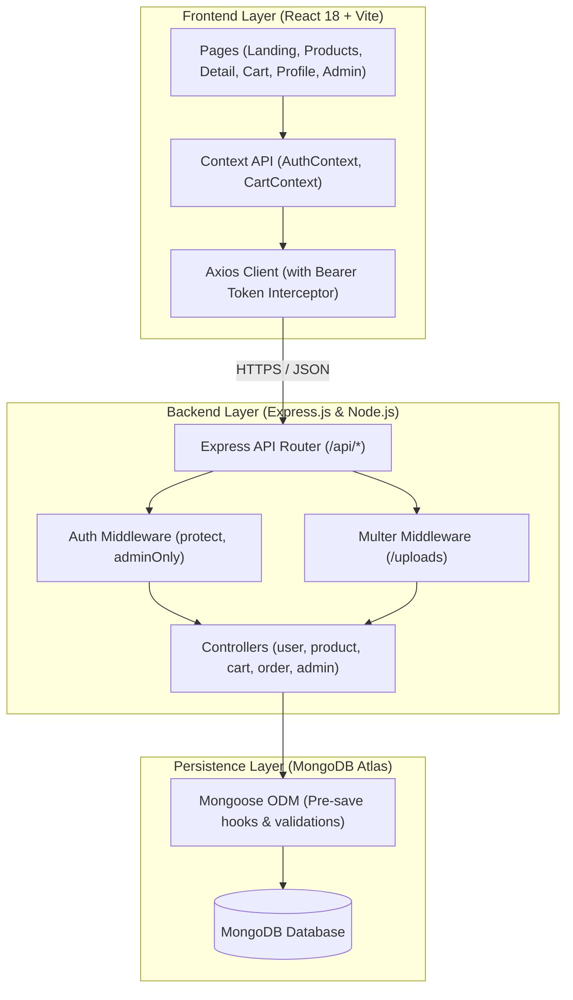

# Full Stack Development with MERN: Project Documentation

## 1. Project Information
- **Project Title:** ShopEZ E-Commerce Web Application
- **Author & Developer:** Ruturaj Misal ([ruturaj1804](https://github.com/ruturaj1804))
- **GitHub Repository:** [https://github.com/ruturaj1804/-ShopEZ](https://github.com/ruturaj1804/-ShopEZ)
- **Technology Stack:** MongoDB, Express.js, React 18, Node.js (MERN), Vite, Axios, JWT, Multer

---

## 2. Project Overview

### Purpose
**ShopEZ** is a modern, full-featured e-commerce web platform engineered using the MERN stack. It bridges retail online shoppers and independent merchants by combining:
1. A frictionless, fast storefront for product browsing, filtering, real-time cart synchronization, and Cash on Delivery (COD) checkout.
2. A centralized seller and administrator portal for managing product listings, uploading images via Multer, executing inline inventory edits, tracking order fulfillment statuses, and inspecting revenue metrics.

---

## 3. Key Features

### For Customers / Shoppers
- **Secure Authentication:** User registration, password encryption with `bcryptjs` (10 rounds), and persistent JWT bearer authentication stored in `localStorage`.
- **Dynamic Product Catalog:** Explore products categorized into Electronics, Clothing, Footwear, Home, and Books with instant keyword search and price/rating sorting.
- **Product Details & Customer Feedback:** Single product view displaying high-resolution images, discount percentages, stock availability badges, and an interactive customer review submission system with 1-5 star ratings.
- **Persistent Shopping Cart:** Add products with instant navbar badge updates, real-time quantity increment/decrement, dynamic subtotal calculations, and cart clearance.
- **Frictionless Checkout:** Fast checkout form capturing shipping address details (address, city, state, zip code, country) and Cash on Delivery (COD) payment.
- **Order Tracking & Profile:** Comprehensive order history timeline in User Profile displaying status badges (`Processing`, `Shipped`, `Delivered`, `Cancelled`).

### For Sellers & Platform Administrators
- **Seller Central (`/admin/sell`):** Dedicated seller command center displaying inventory items, sales figures, and quick management tools.
- **Inline Catalog Editing:** Real-time inline editing of product prices and stock quantities directly inside table cells with zero page reloads.
- **Automated Low-Stock Alerts:** Prominent alert indicators triggered when inventory levels fall below 10 units to prevent stockouts.
- **Product Listing with Multer:** Full multipart image upload support for adding new merchandise with descriptions, pricing, discounts, and categories.
- **Order Fulfillment Pipeline:** Comprehensive order management interface (`/admin/orders`) to transition orders between `Processing`, `Shipped`, `Delivered`, and `Cancelled`.
- **Administrative Analytics (`/admin`):** Executive overview cards displaying total platform revenue, total orders placed, product count, and registered users.

---

## 4. System Architecture

ShopEZ implements a 3-tier Model-View-Controller (MVC) architecture designed for responsiveness and scalability.



### Frontend Architecture
- **State Management:** React Context API (`AuthContext` for auth token & user state, `CartContext` for cart state & total price).
- **Navigation & Routing:** React Router DOM (v7) with nested layouts and `ProtectedRoute` guards restricting `/admin/*` routes to admin accounts.
- **Feedback & UI:** React Icons and React Toastify for responsive user notifications.

### Backend Architecture
- **Server Entry:** `Server/index.js` initializes middleware (CORS, JSON parsing, URL encoded, static `/uploads` serving), mounts API routes, and connects to MongoDB.
- **Database Layer:** Mongoose schemas with schema validation, password hashing pre-save hooks (`User`), and cart total calculation hooks (`Cart`).

---

## 5. Database Schema & Data Models

```mermaid
erDiagram
    USER ||--o{ ORDER : places
    USER ||--|| CART : owns
    USER ||--o{ REVIEW : writes
    PRODUCT ||--o{ REVIEW : contains
    ORDER ||--|{ ORDER_ITEM : includes
    CART ||--|{ CART_ITEM : contains
    PRODUCT ||--o{ ORDER_ITEM : references
    PRODUCT ||--o{ CART_ITEM : references

    USER {
        ObjectId _id PK
        string name
        string email UK
        string password "hashed with bcrypt"
        string phone
        string address
        string role "user | admin"
        date createdAt
    }

    PRODUCT {
        ObjectId _id PK
        string name
        string description
        number price
        number discount
        string category
        string image
        number stock
        number rating
        number numReviews
    }

    CART {
        ObjectId _id PK
        ObjectId user FK
        number totalPrice
    }

    ORDER {
        ObjectId _id PK
        ObjectId user FK
        object shippingAddress
        string paymentMethod "COD"
        number totalPrice
        boolean isPaid
        string orderStatus "Processing | Shipped | Delivered | Cancelled"
        date deliveredAt
    }
```



---

## 6. API Documentation

All backend endpoints are prefixed with `/api`. Protected routes require an HTTP header: `Authorization: Bearer <JWT>`.

### Authentication & User Routes (`/api/users`)
| Method | Endpoint | Access | Description |
| :--- | :--- | :--- | :--- |
| **POST** | `/api/users/register` | Public | Register new user account with name, email, password |
| **POST** | `/api/users/login` | Public | Authenticate user and issue JWT token |
| **GET** | `/api/users/profile` | User | Fetch logged-in user profile details |
| **PUT** | `/api/users/profile` | User | Update user profile (name, phone, address) |

### Product Routes (`/api/products`)
| Method | Endpoint | Access | Description |
| :--- | :--- | :--- | :--- |
| **GET** | `/api/products` | Public | List products (supports query params: `search`, `category`, `sort`) |
| **GET** | `/api/products/:id` | Public | Fetch single product by its ObjectId |
| **POST** | `/api/products` | Admin | Create product with Multer image upload (`multipart/form-data`) |
| **PUT** | `/api/products/:id` | Admin | Update product information (supports inline price & stock updates) |
| **DELETE**| `/api/products/:id` | Admin | Delete a product from inventory |
| **POST** | `/api/products/:id/reviews` | User | Submit customer review (rating 1–5 and comment) |

### Cart Routes (`/api/cart`)
| Method | Endpoint | Access | Description |
| :--- | :--- | :--- | :--- |
| **GET** | `/api/cart` | User | Fetch user's persistent cart and total price |
| **POST** | `/api/cart/add` | User | Add item to cart (payload: `productId`, `quantity`) |
| **PUT** | `/api/cart/:itemId` | User | Update quantity of a cart item |
| **DELETE**| `/api/cart/:itemId` | User | Remove item from cart |
| **DELETE**| `/api/cart/clear/all` | User | Empty the entire shopping cart |

### Order Routes (`/api/orders`)
| Method | Endpoint | Access | Description |
| :--- | :--- | :--- | :--- |
| **POST** | `/api/orders` | User | Create new order (address, items, COD payment) |
| **GET** | `/api/orders/myorders` | User | Fetch order history for the logged-in user |
| **GET** | `/api/orders/:id` | User | Get details of a specific order |
| **GET** | `/api/orders/all` | Admin | Retrieve all customer orders across the platform |
| **PUT** | `/api/orders/:id/status`| Admin | Update order status (`Processing`, `Shipped`, `Delivered`, `Cancelled`) |
| **DELETE**| `/api/orders/:id` | Admin | Delete order record |

### Admin & Analytics Routes (`/api/admin`)
| Method | Endpoint | Access | Description |
| :--- | :--- | :--- | :--- |
| **GET** | `/api/admin/dashboard`| Admin | Get aggregated statistics (total revenue, orders, products, users) |
| **GET** | `/api/admin/users` | Admin | List all registered users |
| **DELETE**| `/api/admin/users/:id` | Admin | Delete user account |
| **GET** | `/api/admin/settings` | Public | Retrieve site metadata and settings |
| **PUT** | `/api/admin/settings` | Admin | Update site settings |

---

## 7. Application Setup & Running

### Prerequisites
- **Node.js** (v16 or higher)
- **MongoDB** (Local instance on `mongodb://localhost:27017` or MongoDB Atlas cluster URI)
- **npm** or **yarn**

### Installation Steps

1. **Clone the Repository:**
   ```bash
   git clone https://github.com/ruturaj1804/-ShopEZ.git
   cd "E-commerce Application"
   ```

2. **Configure Backend Environment:**
   Create a `.env` file in the `Server` folder:
   ```env
   MONGO_URI=mongodb://localhost:27017/shopez
   JWT_SECRET=shopez_super_secret_jwt_key
   PORT=8000
   ```

3. **Install Dependencies & Seed Initial Data:**
   ```bash
   # Backend
   cd Server
   npm install
   node seed.js    # Seeds demo products, categories, and default admin

   # Frontend
   cd ../Client
   npm install
   ```

4. **Run the Application:**
   ```bash
   # Terminal 1 - Backend Server (runs on http://localhost:8000)
   cd Server
   npm run dev

   # Terminal 2 - Frontend Client (runs on http://localhost:5173)
   cd Client
   npm run dev
   ```

5. **Default Admin Credentials:**
   - **Email:** `admin@shopez.com`
   - **Password:** `admin123`

---

## 8. Deployment Architecture (Vercel & Cloud DB)

- **Frontend:** Built via `vite build` and served on Vercel's global CDN Edge Network.
- **Backend API:** Configured via root `vercel.json` rewrite rules routing `/api/(.*)` to `/Server/index.js` as a serverless function.
- **Database:** Connects to **MongoDB Atlas** with connection string configured in Vercel Environment Variables (`MONGO_URI`).
- **Production Environment Variables:** Set `NODE_ENV=production`, `MONGO_URI`, and `JWT_SECRET` in the Vercel dashboard.

---

## 9. Phase-Wise Implementation Reference

All academic and development phase documents are organized under `Phase Wise/`:
- **Phase 1: Brainstorming & Ideation Phase**
  - [Define Problem Statements](file:///d:/E-commerce%20Application/Phase%20Wise/Brainstorming%20&%20Ideation%20Phase/Define%20Problem%20Statements.md)
  - [Empathy Map Canvas](file:///d:/E-commerce%20Application/Phase%20Wise/Brainstorming%20&%20Ideation%20Phase/Empathy%20Map%20Canvas.md)
  - [Brainstorming & Idea Prioritization](file:///d:/E-commerce%20Application/Phase%20Wise/Brainstorming%20&%20Ideation%20Phase/Brainstorming-%20Idea%20Generation-%20Prioritization.md)
- **Phase 2: Project Planning Phase**
  - [Project Planning, Backlog & Sprints](file:///d:/E-commerce%20Application/Phase%20Wise/Project%20Planning%20Phase/Project%20Planning%20.md)
- **Phase 3: Requirement Analysis**
  - [Solution Requirements (FR & NFR)](file:///d:/E-commerce%20Application/Phase%20Wise/Requirement%20Analysis/Solution%20Requirements.md)
  - [Technology Stack Specification](file:///d:/E-commerce%20Application/Phase%20Wise/Requirement%20Analysis/Technology%20Stack.md)
  - [Data Flow Diagrams & User Stories](file:///d:/E-commerce%20Application/Phase%20Wise/Requirement%20Analysis/Data%20Flow%20Diagrams%20User%20Stories.md)
- **Phase 4: Project Design Phase**
  - [Problem - Solution Fit](file:///d:/E-commerce%20Application/Phase%20Wise/Project%20Design%20Phase/Problem%20-%20Solution%20Fit%20Template/Problem%20Solution%20Fit.md)
  - [Proposed Solution Specification](file:///d:/E-commerce%20Application/Phase%20Wise/Project%20Design%20Phase/Proposed%20Solution/Proposed%20Solution.md)
  - [Solution Architecture & Data Models](file:///d:/E-commerce%20Application/Phase%20Wise/Project%20Design%20Phase/Solution%20Architecture/Solution%20Architecture.md)
- **Phase 5: Project Development & Testing**
  - [User Acceptance Testing (UAT) & FSD](file:///d:/E-commerce%20Application/Phase%20Wise/Project%20Developement/User%20Acceptance%20Testing%20FSD.md)
