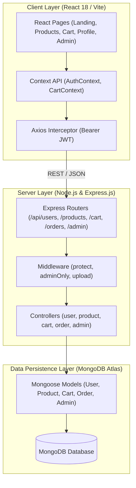
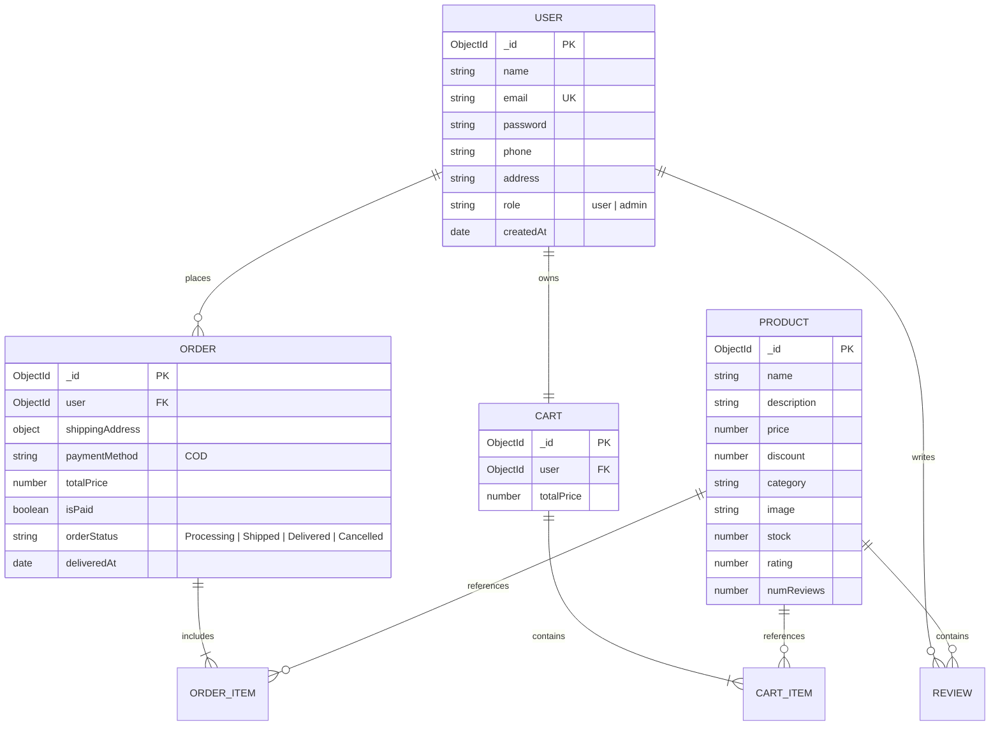

# Project Design Phase: Solution Architecture

| Meta Attribute | Value |
| :--- | :--- |
| **Date** | 12 August 2026 |
| **Team ID** | N/A |
| **Project Name** | ShopEZ Ecommerce Application |
| **Author / Repo** | Ruturaj Misal ([https://github.com/ruturaj1804/-ShopEZ](https://github.com/ruturaj1804/-ShopEZ)) |
| **Maximum Marks** | 4 Marks |

---

## 1. High-Level Architecture
ShopEZ implements a 3-tier layered architecture adhering to the Model-View-Controller (MVC) pattern.

---

## 2. Database Entity Relationship (ER) Schema

---

## 3. Security Architecture
- **JWT Authentication:** Tokens signed with `JWT_SECRET`, transmitted via HTTP headers `Authorization: Bearer <token>`, and verified by Express `protect` middleware.
- **Password Salting:** Passwords hashed with `bcryptjs` using 10 rounds before storing in MongoDB.
- **Role-Based Guards (`adminOnly`):** Validates that `req.user.role === 'admin'` before allowing administrative and seller route access.
- **CORS Allowlist:** Configured to allow trusted origins during development and production.
