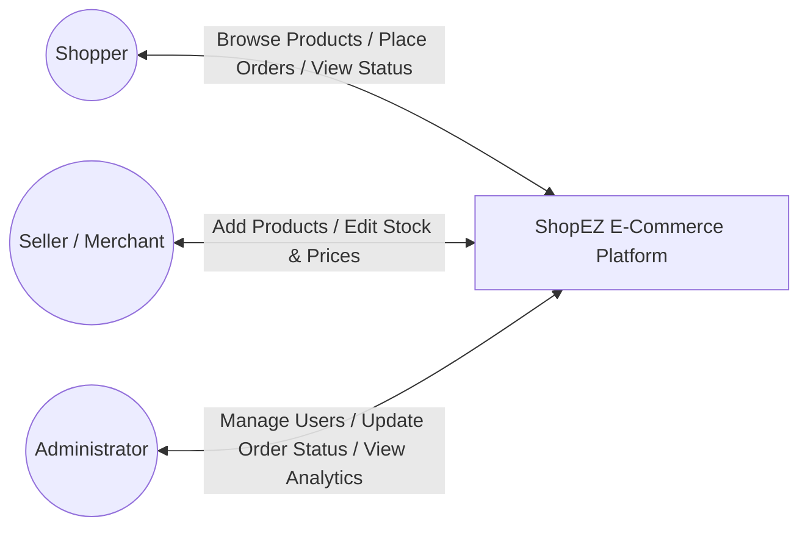
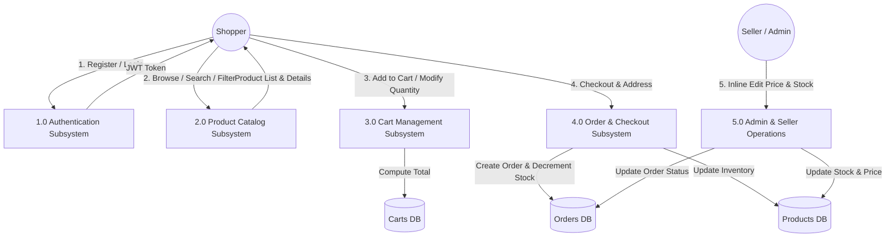

# Requirement Analysis: Data Flow Diagrams & User Stories

| Meta Attribute | Value |
| :--- | :--- |
| **Date** | 12 August 2026 |
| **Team ID** | N/A |
| **Project Name** | ShopEZ Ecommerce Application |
| **Author / Repo** | Ruturaj Misal ([https://github.com/ruturaj1804/-ShopEZ](https://github.com/ruturaj1804/-ShopEZ)) |
| **Maximum Marks** | 4 Marks |

---

## 1. Data Flow Diagrams (DFD)

### DFD Level 0 (Context Diagram)

### DFD Level 1 (Subsystems)

---

## 2. User Stories Matrix

| User Role | Epic | Story ID | User Story Description | Acceptance Criteria | Story Points |
| :--- | :--- | :--- | :--- | :--- | :--- |
| **Shopper** | Auth | USN-01 | As a new user, I want to register with my name, email, and password. | Validates email format, minimum 6 character password, hashes password, returns JWT. | 5 |
| **Shopper** | Auth | USN-02 | As a registered user, I want to log in and stay authenticated across sessions. | Returns JWT token, stores user in AuthContext & localStorage, redirects to landing. | 3 |
| **Shopper** | Catalog | USN-03 | As a shopper, I want to browse products with search and category filters. | Filtering by category, search by product name/description, real-time results. | 5 |
| **Shopper** | Catalog | USN-04 | As a shopper, I want to view detailed product information and reviews. | Shows product image, price, discount, in-stock badge, and list of customer reviews. | 3 |
| **Shopper** | Catalog | USN-05 | As an authenticated shopper, I want to post a rating and review on a product. | Select 1-5 stars, submit comment, updates average product rating immediately. | 3 |
| **Shopper** | Cart | USN-06 | As a shopper, I want to add items to my shopping cart. | Updates cart item count in navbar, recalculates total amount on the fly. | 3 |
| **Shopper** | Cart | USN-07 | As a shopper, I want to modify item quantities or remove items from my cart. | Quantity update refreshes line totals; removing item removes it from database cart. | 3 |
| **Shopper** | Checkout | USN-08 | As a shopper, I want to place an order with my shipping address and COD. | Validates address fields, creates Order document, clears cart, redirects to profile. | 5 |
| **Shopper** | Orders | USN-09 | As a shopper, I want to view my past orders and their status in my profile. | Lists all past orders with ordered items, total cost, and delivery status badge. | 3 |
| **Seller** | Inventory | USN-10 | As a seller, I want to view all inventory on `/admin/sell` with inline editing. | Directly edit price and stock values in table cells with auto-save to MongoDB. | 5 |
| **Seller** | Inventory | USN-11 | As a seller, I want warning alerts when products have less than 10 units left. | Displays prominent warning badge when item stock is low (< 10 units). | 3 |
| **Admin** | Management | USN-12 | As an admin, I want to add new products with images via multipart upload. | Form with Multer image upload, validates required fields, adds product to catalog. | 5 |
| **Admin** | Governance | USN-13 | As an admin, I want to view platform analytics (revenue, total orders, users). | Fetches aggregations from `/api/admin/dashboard` and renders metrics cards. | 5 |
| **Admin** | Governance | USN-14 | As an admin, I want to update customer order statuses (Processing, Shipped, Delivered). | Dropdown in order management table updates MongoDB order status instantly. | 3 |
